<!-- Todos os cards são SVGs gerados por generate.py e atualizados todo dia pelo workflow update-profile.yml.
     O espaçamento já está dentro dos SVGs: mantenha este bloco sem linhas em branco e sem espaços entre as imagens de uma mesma fileira. -->

 
 
 
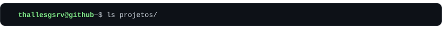 
<!-- PROJECTS:START -->
<a href="https://github.com/Faeueu/busca_de_dados">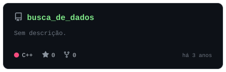</a><a href="https://github.com/Faeueu/countingSort">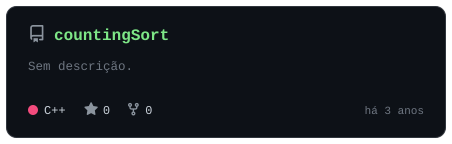</a><a href="https://github.com/Faeueu/linkedList">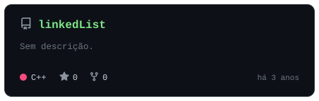</a> 
<a href="https://github.com/Faeueu/projeto1_cinema">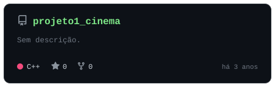</a><a href="https://github.com/Faeueu/reajuste_salarial.cpp">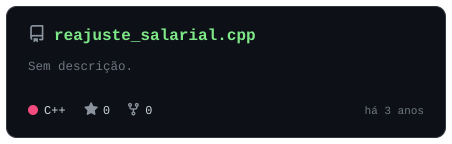</a><a href="https://github.com/Faeueu/ProjetoVendaDePassagem">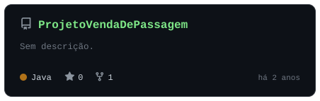</a>
<!-- PROJECTS:END -->
 
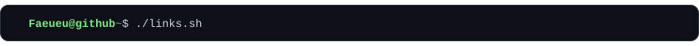

